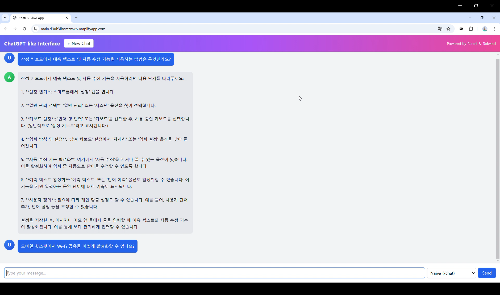
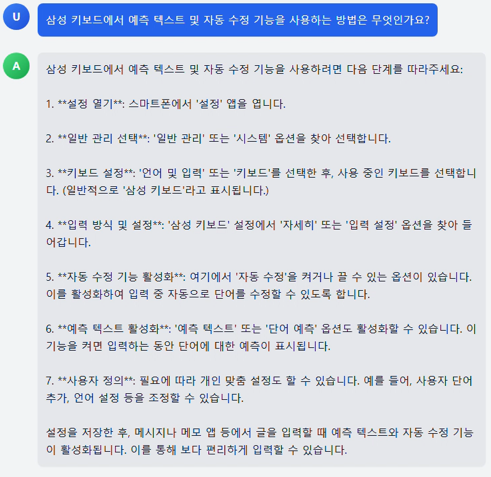
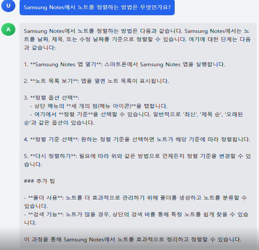
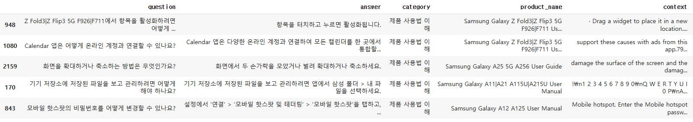

# 제품 맞춤형 QA 챗봇 서비스

<p align="center">
  
</p>

SSAFY DATA 프로젝트 : 제품 매뉴얼 데이터셋을 통한 RAG 기반 QA 챗봇 시스템 개발

개발 기간 : 2024/12/18 ~ 2024/12/26 (약 2주)

## 프로젝트 소개

본 프로젝트는 AI 기반의 자연어 처리 기술을 활용하여, 방대한 제품 매뉴얼로부터 사용자가 원하는 정보를 쉽고 빠르게 제공하는 제품 맞춤형 QA 챗봇 서비스입니다.

기존 FAQ의 한계를 보완하여, 사용자의 질문에 실시간으로 관련 매뉴얼 정보를 탐색하고 정제된 답변을 제공합니다.

### 배포 주소

개발 버전: `https://main.d3uk3ibomzwwiv.amplifyapp.com/`<br>
Frontend 서버: `http://localhost:1234/`<br>
Backend 서버: `https://ssafy-2024-backend-dry-star-6304.fly.dev`<br>

### 팀 소개

| 이름   | 역할            | GitHub 링크                                | 비고                           |
| ------ | --------------- | ------------------------------------------ | ------------------------------ |
| 김찬호 | 프론트엔드 개발 | [@nonamed19](https://github.com/nonamed19) | Tailwind 기반 UI 구성          |
| 김지승 | 백엔드 개발     |                                            | FastAPI / LangChain / Pinecone |
| 우성문 | 데이터 처리     |                                            | QA Pair 생성 및 품질 평가      |
| 안정길 | AI 응답 모델링  |                                            | Upstage 모델 fine-tune         |

---

## 시작 가이드

### Requirements

For building and running the application you need:

```
- Python 3.9+
- Node.js LTS (20+)
- FastAPI
- OpenAI API Key
- Pinecone API Key
- Upstage API Key
```

### Installation

```bash
$ git clone https://github.com/nonamed19/Chatbot_Service_Manual_Based.git
$ cd qa-chatbot-service
```

#### Backend

```bash
$ cd backend
$ python -m venv venv
$ source venv/bin/activate
$ pip install -r requirements.txt
# 최초 1회: PDF를 로컬 FAISS 인덱스로 생성
$ python -m app.embed
# 개발 서버 실행
$ python main.py
```

#### Frontend

```bash
$ cd ../frontend
$ npm install
$ npm start
```

`backend/.env`에는 `UPSTAGE_API_KEY`가 필요합니다. Assistant 모드를 사용할 때만
`OPENAI_API_KEY`, `ASSISTANT_BOT_ID`를 추가하면 됩니다. 프런트엔드의 API 주소는
`frontend/.env`의 `API_ENDPOINT=http://127.0.0.1:8000`으로 설정할 수 있습니다.

## 기술 스택

### Environment

- OS: Windows
- Backend : Django
- Frontend : JavaScript
- API : OpenAI Assistant API

### Config

- Upstage Solar LLM : Few-shot QA 생성, 카테고리 분류, 데이터 품질 평가 및 보완
- Pinecone : 벡터 검색(MMR, similarity), 대규모 검색 최적화
- LangChain : 체인 생성, 검색 기반 응답 구성(RAG), 프롬프트 템플릿화
- Selenium : 웹 크롤링, 자동화된 클릭/스크롤, PDF 링크 수집
- Fly.io : Edge 지역 분산 호스팅, 자동 HTTPS, CLI 기반 배포

### Development

- Backend: Django + FastAPI + LangChain + Upstage Chat + OpenAI API
- Frontend: Vanilla JS + TailwindCSS + Parcel
- DB : Pinecone, AWS Lambda

### Communication

- GitHub
- GitLab
- Notion

## 화면 구성

|                          QA 화면(Naive Mode)                           |                             QA 화면(Assistant Mode)                             |
| :--------------------------------------------------------------------: | :-----------------------------------------------------------------------------: |
|  |  |

## 주요 기능

- 사용자 질문에 맞춘 제품 정보 실시간 제공
- QA Pair 데이터셋 기반 챗봇 학습 및 개선
- IndexedDB 기반 대화 저장 및 로컬 기록 관리
- OpenAI Assistant API 및 LangChain 기반 MMR 검색 기능 제공
- Pinecone 벡터 저장소를 활용한 유사도 검색

## 아키텍쳐

### Data Flow

```
1. 삼성 갤럭시 PDF 매뉴얼 수집 (Selenium)
2. Upstage Document Parser → Markdown 변환
3. 텍스트 정제 및 QA Pair 생성 (Solar LLM)
4. Pinecone에 임베딩 저장 (MMR 기반 검색)
5. LangChain RetrievalQA → 사용자 질문 대응
```

## 데이터 통계

### 데이터셋 구조



```
질문, 답변, 분류를 기준으로 데이터 셋 구축
Upstage Solar LLM을 이용해 20개 데이터의 QA Pair 생성
QA 데이터셋 품질 평가는 Randome sampling으로 200건을 추출하여 Hallucination, Answer Relevancy, Toxicity를 활용해 정량적 평가
전체 데이터 셋 중 일부를 추출해 연관성, 불용어, 정확성 등을 기준으로 평가 실시
```

## 품질 평가 및 성과

### Metric Score

|  품질 평가 기준  | 평가 결과 |
| :--------------: | :-------: |
|  Hallucination   |    93%    |
| Answer Relevancy |    95%    |
|     Toxicity     |   100%    |

### 카테고리 별 성공률 시각화

|  품질 평가 기준   | 평가 결과 |
| :---------------: | :-------: |
|     문제 해결     |   100%    |
| 제품 사용법 이해  |    90%    |
| 정보 탐색 및 선택 |    83%    |

### 평가 결과

전반적인 데이터 품질 현황

- 전체적인 성공률이 70~100% 범위로 기본적인 품질 수준 확보
- Toxicity(~100%)와 Answer relevancy(~95%) 지표는 우수한 성과
- Hallucination(~93%) 지표가 상대적 취약점으로 파악

제품군별 특성

- Galaxy Note Series: 가장 높은 품질 수준(성공률 ~100%)
- Galaxy S Series: 품질 편차가 크며, 특히 Galaxy A11|A12 모델에서 개선 필요
- Galaxy A Series: 품질 편차가 크며, 특히 Galaxy S20 모델에서 개선 필요
- Wearable/IoT 기기: 높은 수준의 품질 수준(성공률 ~95%)

## 기타 추가 사항들

향후 계획 :

- 자동화된 품질 검증 시스템 구축
- 제품별 맞춤형 챗봇 튜닝
- Serverless 기반 성능 최적화
- 사용자 피드백 기반 정기적 개선 루프 도입
