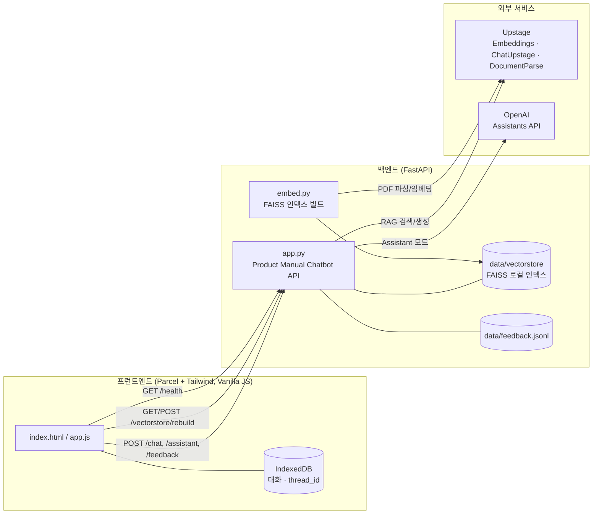

# Manual AI · 제품 지원 챗봇

> 제품 매뉴얼(PDF)에 근거한 정확한 답변과, 맥락을 이어가는 AI Assistant를 한 화면에서 제공하는 온프레미스 지향 제품 지원 챗봇


---

## 프로젝트 소개

**Manual AI**는 특정 제품 매뉴얼을 지식 베이스로 삼아 사용자 질문에 답하는 웹 챗봇입니다. 두 가지 답변 방식을 하나의 UI에서 전환하며 사용할 수 있습니다.

- **매뉴얼 검색 (RAG)**: 매뉴얼 PDF를 로컬 FAISS 인덱스로 임베딩한 뒤, Upstage LLM으로 근거 문서와 함께 답변을 생성합니다. 답변에는 출처(문서 제목, 페이지, 발췌문)가 함께 표시됩니다.
- **AI Assistant**: OpenAI Assistants API의 thread를 사용해 이전 대화 맥락을 이어가는 자유로운 대화형 지원을 제공합니다.

기본 매뉴얼은 `data/Galaxy_A_35.pdf` (Galaxy A35)이며, 프런트엔드의 `인덱스 생성` 버튼이나 CLI로 다른 PDF에 맞춰 벡터 스토어를 재생성할 수 있습니다.

### 주요 특징

| 특징 | 설명 |
| --- | --- |
| 근거 기반 답변 | RAG 응답마다 최대 3개의 매뉴얼 근거(제목/페이지/발췌)를 함께 반환 |
| 두 가지 답변 모드 | 매뉴얼 검색(RAG)과 맥락 유지형 AI Assistant를 UI에서 즉시 전환 |
| 무중단 인덱스 재생성 | 스테이징 디렉터리에서 새 인덱스를 만든 뒤 원자적 교체, 실패 시 기존 인덱스로 롤백 |
| 로컬 우선 저장 | 대화 기록과 스레드 ID를 브라우저 IndexedDB에 저장, 서버는 상태를 보관하지 않음 |
| 답변 피드백 수집 | 👍/👎 및 코멘트를 JSON Lines(`feedback.jsonl`)로 적재해 추후 품질 평가에 활용 |
| 동시성 제어 | `asyncio.Semaphore`로 동시 요청 수를 제한(기본 4) |
| 부분 기동 허용 | RAG 미구성 시에도 서버가 기동되어 `/health`, Assistant 모드는 정상 동작 |

---

## 아키텍처



- **RAG 경로**: `/chat` → 로컬 FAISS 리트리버(MMR, `k=3`, `fetch_k=12`) → `ChatUpstage`로 답변 생성 → 근거 문서 반환
- **Assistant 경로**: `/assistant` → OpenAI thread 생성/갱신 → `create_and_poll`로 실행 → 최신 assistant 메시지 반환
- **인덱스 재생성**: `/vectorstore/rebuild` → 백그라운드 태스크가 스테이징 디렉터리에 새 인덱스 생성 → 검증 후 원자적 교체

---

## 디렉터리 구조 (추론)

> 아래 구조는 워크스페이스의 평탄화된 파일을 상대 임포트(`from .embed`), uvicorn 경로(`app.app:app`), `index.html`의 `./src/` 참조를 근거로 재구성한 것입니다. 실제 리포지토리에서 경로를 검증하세요.

```
.
├── backend/
│   ├── main.py                 # 진입점: run.main() 호출
│   ├── run.py                  # uvicorn 러너 (app.app:app)
│   ├── requirements.txt        # Python 3.11 대상 의존성
│   ├── app/
│   │   ├── __init__.py
│   │   ├── app.py              # FastAPI 앱, 라우터, 스키마
│   │   └── embed.py            # PDF → FAISS 인덱스 생성
│   └── data/                   # 런타임 생성 (git 미포함 권장)
│       ├── Galaxy_A_35.pdf     # 기본 매뉴얼 PDF (직접 배치 필요)
│       ├── vectorstore/        # FAISS 인덱스
│       └── feedback.jsonl      # 답변 피드백 로그
└── frontend/
    ├── index.html              # 앱 셸, ./src 참조
    ├── package.json            # Parcel 스크립트, gh-pages 배포
    ├── package-lock.json
    ├── tailwind.config.js      # (워크스페이스에서는 tailwind_config.js)
    ├── .postcssrc              # (워크스페이스에서는 _postcssrc.json)
    └── src/
        ├── app.js              # 대화 로직, IndexedDB, API 호출
        └── styles.css          # UI 스타일 (Tailwind 지시어 포함)
```

---

## 시작하기

### 요구 사항

- Python 3.11
- Node.js 18+ (Parcel 2 권장)
- Upstage API 키 (매뉴얼 검색/임베딩에 필수)
- OpenAI API 키 및 Assistant ID (Assistant 모드 사용 시)

### 1. 백엔드 설정

```bash
# 1) 리포지토리 클론
git clone [REPO_URL]
cd backend

# 2) 가상 환경 및 의존성 설치
python -m venv .venv
source .venv/bin/activate          # Windows: .venv\Scripts\activate
pip install -r requirements.txt

# 3) 환경 변수 파일 생성 (아래 "환경 변수" 표 참고)
cp .env.example .env               # 예시 파일이 있다면
```

`.env` 예시 (실제 키는 절대 커밋하지 마세요):

```dotenv
# 매뉴얼 검색(RAG) - 필수
UPSTAGE_API_KEY=[YOUR_UPSTAGE_API_KEY]

# AI Assistant 모드 - 선택
OPENAI_API_KEY=[YOUR_OPENAI_API_KEY]
ASSISTANT_BOT_ID=[YOUR_ASSISTANT_BOT_ID]

# 서버/동작 옵션 - 선택 (기본값은 아래 표 참고)
HOST=0.0.0.0
PORT=8000
CORS_ALLOW_ORIGINS=http://localhost:1234,http://127.0.0.1:1234
MAX_CONCURRENT_REQUESTS=4
```

매뉴얼 PDF를 `data/Galaxy_A_35.pdf`에 배치한 뒤, 벡터 스토어를 생성합니다.

```bash
# CLI로 인덱스 생성 (app 패키지 기준)
python -m app.embed
# 완료 시: "Embedding done. Saved <N> chunks to: .../data/vectorstore"

# 서버 실행
python main.py
# 또는
python run.py
```

> 인덱스가 없으면 서버는 정상 기동하되 RAG는 비활성 상태가 됩니다(로그에 경고 출력). 이후 프런트엔드의 `인덱스 생성` 버튼이나 `POST /vectorstore/rebuild`로 생성할 수 있습니다.

### 2. 프런트엔드 설정

```bash
cd frontend
npm install

# 개발 서버 (Parcel, 기본 http://localhost:1234)
npm run dev

# 프로덕션 빌드
npm run build

# GitHub Pages 배포
npm run deploy
```

백엔드 주소가 기본값(`http://127.0.0.1:8000`)과 다르면 빌드/실행 시 `API_ENDPOINT` 환경 변수로 지정합니다.

```bash
API_ENDPOINT=https://api.example.com npm run build
```

---

## 환경 변수

### 백엔드

| 변수 | 필수 | 기본값 | 설명 |
| --- | :---: | --- | --- |
| `UPSTAGE_API_KEY` | RAG 사용 시 | - | Upstage 임베딩/LLM/문서 파싱 인증 키 |
| `OPENAI_API_KEY` | Assistant 사용 시 | - | OpenAI Assistants API 키 |
| `ASSISTANT_BOT_ID` | Assistant 사용 시 | - | 사용할 OpenAI Assistant ID |
| `HOST` | - | `0.0.0.0` | 바인딩 호스트 |
| `PORT` | - | `8000` | 바인딩 포트 |
| `RELOAD` | - | `true` | uvicorn 자동 리로드 여부 |
| `CORS_ALLOW_ORIGINS` | - | `http://localhost:1234,http://127.0.0.1:1234,http://localhost:3000,http://127.0.0.1:3000` | 허용 오리진(콤마 구분) |
| `MAX_CONCURRENT_REQUESTS` | - | `4` | 동시 처리 요청 상한 |
| `FEEDBACK_LOG_PATH` | - | `data/feedback.jsonl` | 피드백 로그 저장 경로 |

### 프런트엔드

| 변수 | 기본값 | 설명 |
| --- | --- | --- |
| `API_ENDPOINT` | `http://127.0.0.1:8000` | 백엔드 API 베이스 URL |

---

## 주요 상수 (코드 기준)

| 상수 | 값 | 위치 | 용도 |
| --- | --- | --- | --- |
| `MAX_MESSAGE_LENGTH` | `4000` | `app.py` | 메시지 최대 길이 |
| `MAX_FEEDBACK_COMMENT_LENGTH` | `1000` | `app.py` | 피드백 코멘트 최대 길이 |
| MMR `k` / `fetch_k` | `3` / `12` | `app.py` | 리트리버 검색 파라미터 |
| `chunk_size` / `chunk_overlap` | `1000` / `100` | `embed.py` | 텍스트 분할 크기 |
| 임베딩 모델 | `embedding-query` | `embed.py`, `app.py` | Upstage 임베딩 모델명 |
| `REQUEST_TIMEOUT_MS` | `90000` | `app.js` | 프런트 요청 타임아웃 |
| `MAX_STORED_MESSAGES` | `300` | `app.js` | IndexedDB 보관 메시지 수 |

---

## API 요약

전체 스키마는 서버 기동 후 `http://<host>:<port>/docs` (Swagger UI)에서 확인하세요.

| 메서드 | 경로 | 성공 코드 | 설명 |
| --- | --- | :---: | --- |
| `POST` | `/chat` | 200 | RAG 답변 생성. 응답에 `reply`, `request_id`, `sources[]` 포함 |
| `POST` | `/assistant` | 200 | Assistant 답변 생성. `thread_id`로 대화 맥락 유지 |
| `POST` | `/feedback` | 201 | 답변 피드백(`up`/`down`, 코멘트) 적재 |
| `GET` | `/vectorstore/rebuild` | 200 | 인덱스 재생성 작업 상태 조회(폴링용) |
| `POST` | `/vectorstore/rebuild` | 202 | 인덱스 재생성 백그라운드 작업 시작 |
| `GET` | `/health`, `/` | 200 | 서비스 상태 및 각 기능 준비 여부 반환 |

요청 예시:

```bash
# 매뉴얼 검색(RAG)
curl -X POST http://127.0.0.1:8000/chat \
  -H "Content-Type: application/json" \
  -d '{"message": "화면 밝기를 조절하려면 어떻게 하나요?"}'
```

---

## 데이터 및 프라이버시

- 대화 기록과 Assistant `thread_id`는 **브라우저 IndexedDB**에만 저장됩니다. 서버는 대화를 보관하지 않습니다.
- FAISS 인덱스는 `embed.py`가 로컬에서 생성한 신뢰된 파일로 간주하여 로드합니다(`allow_dangerous_deserialization=True`). 외부에서 받은 인덱스 파일을 그대로 로드하지 마세요.
- 피드백 로그(`feedback.jsonl`)에는 요청 ID, 평가, 모드, 코멘트, 생성 시각만 저장됩니다.

---

## 도움말 및 문서

- API 레퍼런스: 서버 기동 후 `/docs` (Swagger) 또는 `/redoc`
- 데모/배포: [GitHub Pages 홈페이지](https://kimsz123456.github.io/ssafy-2024-frontend/)
- 이슈 및 문의: `[REPO_URL]`의 Issues 탭
- 기여 방법: [docs/CONTRIBUTING.md](docs/CONTRIBUTING.md) *(파일 추가 필요)*

---

## 기여하기

기여를 환영합니다. 자세한 절차는 [docs/CONTRIBUTING.md](docs/CONTRIBUTING.md)를 참고하세요.

- **유지 관리**: `[MAINTAINER_NAME]` (`[MAINTAINER_EMAIL]`)
- 버그 리포트와 기능 제안은 Issue로, 코드 변경은 Pull Request로 제출해 주세요.

---

## 라이선스

이 프로젝트는 `[LICENSE_TYPE]` 라이선스를 따릅니다. 자세한 내용은 [LICENSE](LICENSE) 파일을 참고하세요.
(프런트엔드 `package.json`에는 `ISC`로 명시되어 있으나 별도 `LICENSE` 파일은 아직 없습니다.)

---

## 검증 체크리스트

코드만으로 확정할 수 없어 리포지토리에서 확인/보완이 필요한 항목입니다.

- [ ] `[REPO_URL]` - 실제 저장소 URL
- [ ] `[MAINTAINER_NAME]` / `[MAINTAINER_EMAIL]` - 유지 관리자 정보 (`package.json`의 `author` 비어 있음)
- [ ] `[LICENSE_TYPE]` 확정 및 루트 `LICENSE` 파일 추가 (현재 `package.json`은 `ISC`)
- [ ] `docs/CONTRIBUTING.md` 추가
- [ ] 디렉터리 구조 검증 (`backend/`, `app/`, `frontend/`, `src/` 배치는 임포트 경로 기반 추론)
- [ ] 프런트엔드 설정 파일명 확인: 워크스페이스의 `tailwind_config.js` → `tailwind.config.js`, `_postcssrc.json` → `.postcssrc`
- [ ] `.env.example` 파일 제공 여부
- [ ] `data/Galaxy_A_35.pdf` 배치 및 `data/` 디렉터리의 git 포함/제외 정책
- [ ] `package.json`의 name(`ssafy-2024-frontend`)·homepage가 실제 배포 대상과 일치하는지